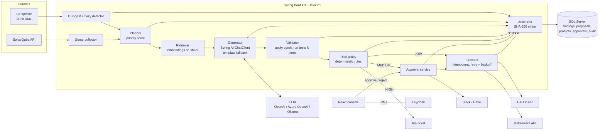
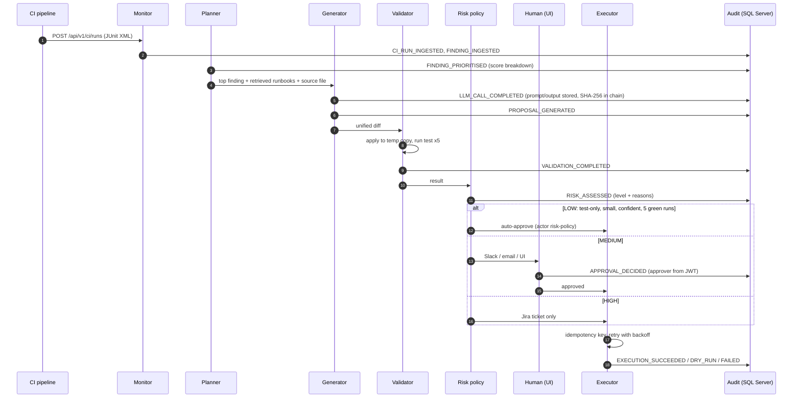
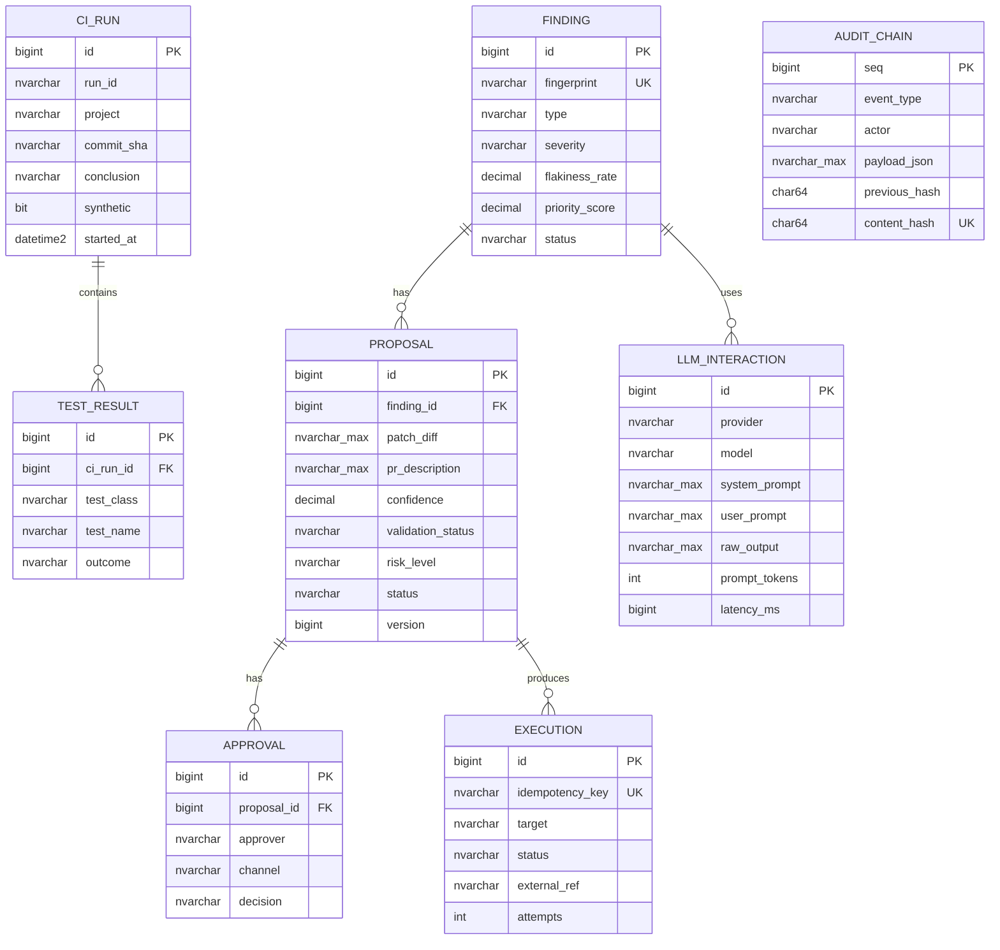

# Architecture

## Components



## Agent cycle



## Risk policy

The model proposes, rules decide. Confidence can only lower the level, never raise it.

| Level | Condition | Action |
|---|---|---|
| HIGH | No patch, patch does not apply, validation failed, or touches `pom.xml`, `src/main/resources/`, `db/migration/`, `security/`, `.github/`, `Dockerfile` | Jira ticket only |
| MEDIUM | Touches `src/main/`, more than 30 changed lines, confidence below 0.7, or fewer than 5 consecutive green test runs | PR after human approval |
| LOW | Test code only, small, confident, 5 green runs | PR opened automatically (still reviewed and CI-gated in Git) |

"Auto-apply" always means a pull request, never a push to the main branch.

## Planner score

```
priority = 0.4 × severity + 0.3 × flakiness rate + 0.2 × business impact + 0.1 × recency
```

Severity: BLOCKER 1.0, CRITICAL 0.8, MAJOR 0.5, MINOR 0.2. Business impact per module in `application.yml`.
Recency decays with a 7-day time constant.

## Flaky test definition

A test is flaky when it both passed and failed on the **same commit SHA** within the last 20 runs. Same code,
different result. Tests that fail consistently are broken, not flaky, and are not flagged.

CI noise = failed runs in which every failing test is a known flaky test, divided by all runs.
The reduction is reported only when at least 5 runs exist on both sides of the first executed fix.

## Data model



## Audit trail

- Each entry hashes `previous_hash, event_type, entity_type, entity_id, actor, payload_json, event_time` with
  SHA-256 over length-prefixed fields (no separator collisions).
- Appends are serialised with `sp_getapplock`, so concurrent writers cannot fork the chain.
- `INSTEAD OF UPDATE` and `INSTEAD OF DELETE` triggers reject changes for every login, including `dbo`.
  The runtime login additionally has `DENY UPDATE, DELETE`.
- Full prompts and model outputs live in `llm_interaction`; their SHA-256 digests are in the chain, so editing a
  stored prompt is detectable.
- `GET /api/v1/audit/verify` recomputes the chain from genesis.
- Stronger option for regulated environments: convert `audit_chain` to a SQL Server **append-only ledger
  table** (`WITH (LEDGER = ON (APPEND_ONLY = ON))`) and store ledger digests in immutable Azure Blob storage.

## Generative AI layer

| Output | Where it appears |
|---|---|
| Root cause and natural-language summary | Dashboard, Jira ticket |
| Reviewer explanation | Proposal page |
| Unified diff patch | Proposal page, GitHub PR |
| PR title and Markdown description | GitHub PR |

Retrieval-augmented: the prompt includes the source file and the top 3 runbook entries from `knowledge_doc`
(cosine similarity over embeddings when an embedding model is configured, BM25 otherwise).
If the model call fails, the deterministic template generator runs instead, its confidence is capped at 0.5,
and the fallback is counted in `codehealth.llm.fallback`.

## Non-functional

| Concern | Implementation |
|---|---|
| Secrets | Environment only; Key Vault references in Azure; `.env` generated locally and git-ignored |
| Idempotency | Unique `execution.idempotency_key`; completed steps are never repeated; CI ingest de-duplicates `runId` |
| Retries | Exponential backoff with jitter, 4 attempts, no retry on 4xx |
| Concurrency | Optimistic locking on findings and proposals; one agent cycle at a time |
| Observability | ECS JSON logs with correlation id, Prometheus metrics, health probes |
| Security | Keycloak JWT, method security, approver from token, CORS allow-list, XXE-safe XML, path traversal checks on patches, HIGH risk can never be approved into a PR, model-written tests run in a locked-down container without secrets |
